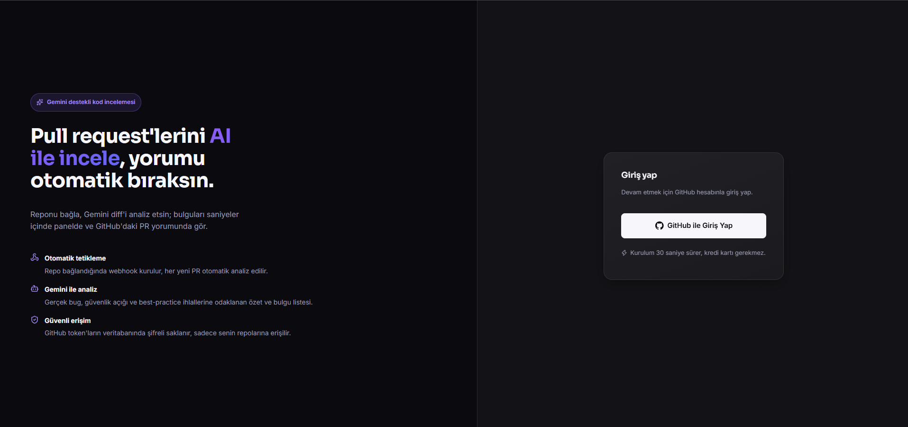
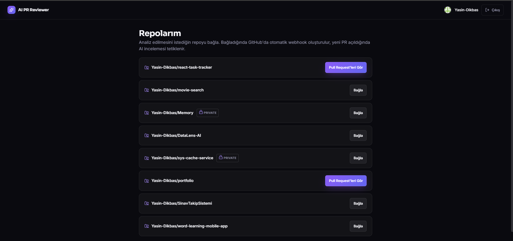
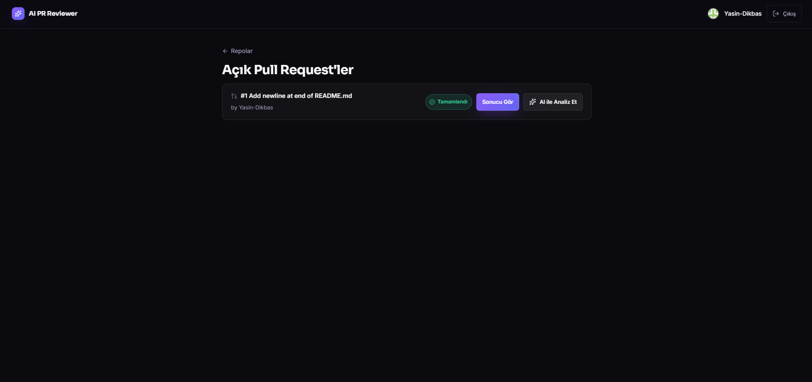
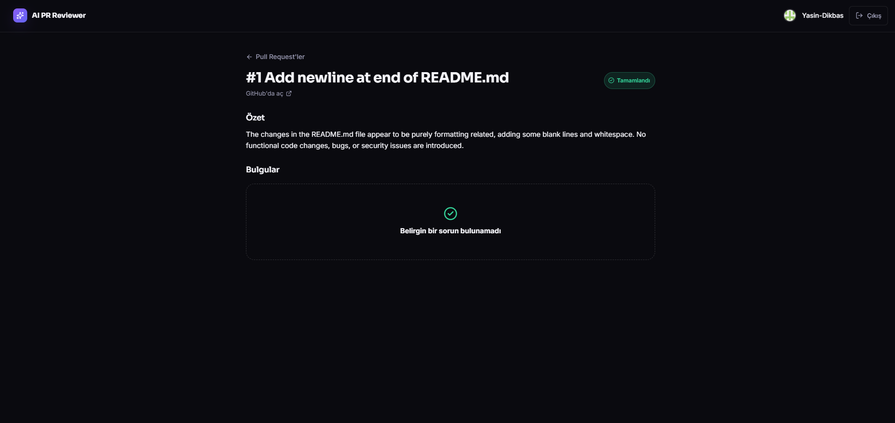

# AI PR Reviewer


GitHub pull request'lerini Gemini ile otomatik analiz eden, bulguları PR'a yorum olarak bırakan bir kod inceleme asistanı.

## Ekran Görüntüleri

| Giriş | Repolarım |
|---|---|
|  |  |

| Pull Request listesi | AI analiz sonucu |
|---|---|
|  |  |

### Demo

https://github.com/Yasin-Dikbas/ai-pr-reviewer/releases/download/demo-assets/demo.mp4

> Video, repo boyutunu şişirmemek için koda commit edilmedi; ayrı bir [GitHub Release](https://github.com/Yasin-Dikbas/ai-pr-reviewer/releases/tag/demo-assets) üzerinden barındırılıyor. Üstteki linke tıklayınca GitHub'ın video oynatıcısında doğrudan izlenebilir.

## Mimari

- **backend/** — Ruby on Rails 8 API (PostgreSQL, Solid Queue ile background job, GitHub OAuth, Octokit, Gemini)
- **frontend/** — React (Vite) SPA; GitHub ile giriş, repo bağlama, PR listesi ve AI inceleme sonuçları

Akış: Kullanıcı GitHub ile giriş yapar → bir repo bağlar (otomatik webhook kurulur) → yeni PR açıldığında ya da "AI ile Analiz Et" butonuna basıldığında backend diff'i çeker → Gemini'ye gönderir → sonucu veritabanına kaydeder ve PR'a yorum olarak ekler.

## Gereksinimler

- Ruby 3.4+, Rails 8+, PostgreSQL (zaten kurulu)
- Node.js 20+
- Bir GitHub hesabı (OAuth App oluşturmak için)
- Bir Gemini API key (ücretsiz, kredi kartı gerekmez: https://aistudio.google.com/apikey)

## 1. GitHub OAuth App Oluşturma

1. https://github.com/settings/developers → **New OAuth App**
2. Alanları doldur:
   - **Application name:** `AI PR Reviewer (dev)`
   - **Homepage URL:** `http://localhost:5173`
   - **Authorization callback URL:** `http://localhost:3000/auth/github/callback`
3. **Register application** → oluşan **Client ID**'yi kopyala
4. **Generate a new client secret** → oluşan secret'i kopyala (bir daha gösterilmez)

## 2. Ortam Değişkenleri

`backend/.env` dosyası zaten oluşturuldu (git'e girmez). İçini doldur:

```
GITHUB_CLIENT_ID=<yukarıdaki Client ID>
GITHUB_CLIENT_SECRET=<yukarıdaki Client Secret>
GITHUB_WEBHOOK_SECRET=<rastgele bir string, örn: openssl rand -hex 20>
GEMINI_API_KEY=<Gemini API key, https://aistudio.google.com/apikey adresinden ücretsiz alınır>
```

`JWT_SECRET` ve `FRONTEND_URL` otomatik dolduruldu, dokunmana gerek yok.

## 3. Backend'i Çalıştırma

```bash
cd backend
bundle install          # ilk kurulumda zaten yapıldı
bin/rails db:create db:migrate   # ilk kurulumda zaten yapıldı
bin/rails server -p 3000
```

PostgreSQL servis olarak kayıtlı değil (bu makinede admin yetkisi gerektiği için atlandı).
Her oturumda önce şunu çalıştırman gerekir:

```bash
"C:\Program Files\PostgreSQL\16\bin\pg_ctl.exe" -D "C:\Program Files\PostgreSQL\16\data" -l "C:\Program Files\PostgreSQL\16\data\logfile.log" start
```

## 4. Frontend'i Çalıştırma

```bash
cd frontend
npm install              # ilk kurulumda zaten yapıldı
npm run dev
```

Tarayıcıda http://localhost:5173 açılır.

## 5. GitHub Webhook'ların Çalışması İçin (opsiyonel, gerçek PR event'leri)

Backend localhost'ta çalıştığı için GitHub doğrudan ona webhook gönderemez. Gerçek "PR açıldığında otomatik analiz" akışını test etmek için [ngrok](https://ngrok.com/) gibi bir tünel aracı gerekir:

```bash
ngrok http 3000
```

Oluşan `https://xxxx.ngrok-free.app` adresini not al. Repo bağlarken backend bu adresi otomatik kullanmaz; demo/geliştirme sırasında bunu manuel olarak GitHub repo ayarlarından (`Settings → Webhooks`) güncelleyebilir veya `register_webhook` metodundaki `request.base_url` değerini ngrok adresiyle değiştirebilirsin.

Webhook kurulmasa da uygulama çalışır: PR listesinde her repo için **"AI ile Analiz Et"** butonuyla manuel tetikleme yapılabilir.

## Teknoloji Özeti

| Katman | Teknoloji |
|---|---|
| Backend | Ruby on Rails 8 (API-only), PostgreSQL, Solid Queue |
| Auth | GitHub OAuth (OmniAuth) + JWT (SPA için stateless auth) |
| AI | Google Gemini API (`gemini-2.5-flash`, ücretsiz katman) |
| GitHub entegrasyonu | Octokit (PR listesi, diff, yorum, webhook kurulumu) |
| Frontend | React 19 + Vite, React Router, Axios |

## Güvenlik Notu

`backend/.env` ve `backend/config/master.key` asla commit edilmez (`.gitignore`'da hariç tutuldu). GitHub access token'ları veritabanında Active Record Encryption ile şifreli saklanır.
